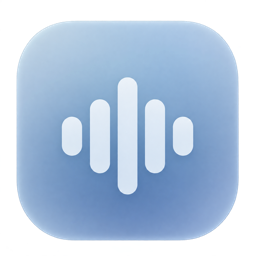

# Veylume

**English** · [Русский](README.ru.md)

Local voice typing for your Mac. Hold a shortcut, speak, and release to put the text where you were typing.

**[Download for Apple silicon](https://github.com/Chernoplodich/Veylume/releases/latest/download/Veylume-arm64.dmg)** · [Release notes](https://github.com/Chernoplodich/Veylume/releases/latest) · [Installation help](docs/installation.md)

Requires **macOS 14 or later** and an **M-series Mac**. Intel Macs are not supported.

> The current download is an early preview, signed with a personal certificate and not notarized by Apple. macOS may ask you to approve opening it. [First-launch instructions](docs/installation.md#opening-the-preview).

## Start dictating

1. Open the DMG and drag **Veylume** to **Applications**.
2. Open the installed app and finish the short setup. Veylume asks for microphone and insertion access, lets you set a shortcut, and downloads its default speech model (about 483 MB).
3. Put the cursor in a text field. Hold your shortcut, speak, then release. **Escape** cancels.

Once the model is installed, dictation works offline. There is no account or subscription.

## Fits into your Mac

Veylume lives in the menu bar. A small indicator shows when you are recording and when your words are being processed. On MacBooks with a camera cutout, it uses the space around the camera when available.

In **Appearance**, choose **Camera cutout** for an integrated indicator or **Compact** for a small capsule. The compact indicator can sit at the top or bottom of your chosen display. If the display has no camera cutout, Veylume uses the compact style.

- **Local speech recognition.** Parakeet V3 is set up automatically; optional Whisper and Cohere models are available in Settings.
- **Your own shortcuts.** Set separate shortcuts for hold-to-record and press-to-toggle.
- **Insertion into other apps.** Use it in text editors, browsers, messaging apps, terminals, and IDEs. It never presses Enter or sends a message. If the destination changes or insertion cannot be attempted safely, the text stays available to copy.
- **Native controls.** SwiftUI and AppKit, with light and dark appearance and support for Reduce Motion.
- **Four interface languages.** English, Russian, Spanish, and French. The interface language is independent of the speech model.
- **Optional launch at login.** Enable it in General; the microphone stays off until you start a recording.

Compatibility depends on the destination app and field. Password fields and Secure Input are protected; automatic insertion is not guaranteed in every field.

## Your words stay on your Mac

Audio and transcripts are processed locally. Model downloads require internet access; dictation does not send speech to a server. Text history is off by default. The last result stays in memory, and optional recovery data is encrypted locally.

[Read the privacy details](docs/privacy.md), including clipboard behavior and how to delete local data.

## Updating

Quit Veylume, replace it with the new copy in the **same Applications folder**, and open it again. Your models and settings stay in place. Opening a newer DMG alone does not update an installed copy. Automatic updates are not available in this preview.

## Help and source code

[Report a problem](https://github.com/Chernoplodich/Veylume/issues/new/choose) · [Build from source](docs/building.md) · [Contributing](CONTRIBUTING.md) · [Security](SECURITY.md)

Veylume's code is available under the [MIT license](LICENSE). Its libraries and downloadable models have their own [licenses and acknowledgements](THIRD_PARTY_NOTICES.md).

If Veylume is useful to you, a star helps other Mac users find it.
