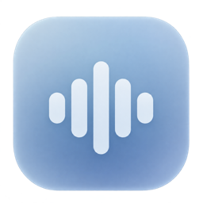

# Veylume

[English](README.md) · **Русский**

Диктовка на вашем Mac. Удерживайте назначенную клавишу, говорите и отпустите — текст появится там, где стоял курсор.

**[Скачать для Mac с M-чипом](https://github.com/Chernoplodich/Veylume/releases/latest/download/Veylume-arm64.dmg)** · [Что нового](https://github.com/Chernoplodich/Veylume/releases/latest) · [Помощь с установкой](docs/ru/installation.md)

Нужны **macOS 14 или новее** и **Mac с Apple Silicon**. Версии для Intel пока нет.

> Сейчас доступна предварительная версия с личной подписью, без нотариализации Apple. При первом открытии macOS может попросить подтвердить запуск. [Как открыть приложение](docs/ru/installation.md#первое-открытие).

## Начните с короткой фразы

1. Откройте DMG и перетащите **Veylume** в **«Программы»**.
2. Запустите установленную копию и пройдите короткую настройку. Приложение попросит доступ к микрофону и вставке, предложит назначить клавишу и само скачает базовую модель речи — около 483 МБ.
3. Поставьте курсор в поле ввода. Удерживайте своё сочетание, произнесите фразу и отпустите. **Escape** отменяет запись.

После загрузки модели можно диктовать без интернета. Регистрация и подписка не нужны.

## Всё необходимое для диктовки

Veylume работает в строке меню. Небольшой индикатор показывает запись и обработку речи. На MacBook с вырезом камеры он занимает свободное место рядом с ним, когда это позволяет строка меню.

- **Распознавание на компьютере.** Parakeet V3 готовится автоматически. Другие модели Whisper и Cohere можно скачать в настройках.
- **Две отдельные клавиши.** Одну можно удерживать для записи, другую — нажимать для начала и остановки.
- **Вставка в рабочие приложения.** Редакторы, браузеры, мессенджеры, терминалы и IDE. Veylume не нажимает Enter и не отправляет сообщения. Если поле изменилось или безопасная вставка недоступна, результат можно скопировать вручную.
- **Нативный интерфейс.** SwiftUI и AppKit, светлая и тёмная темы, учёт системного уменьшения движения.
- **Четыре языка интерфейса.** Русский, английский, испанский и французский. Язык приложения выбирается отдельно от языка речи.
- **Автозапуск по желанию.** Включается в разделе «Общее». При входе в систему микрофон сам не включается.

Поддержка вставки зависит от приложения и типа поля. Защищённые поля паролей и Secure Input не обходятся; автоматическая вставка возможна не везде.

## Речь остаётся на вашем Mac

Звук и текст обрабатываются локально. Интернет нужен для скачивания моделей; сама диктовка не отправляет речь на сервер. История текста изначально выключена. Последний результат хранится в памяти, а временные данные восстановления шифруются на компьютере.

[Подробнее о приватности](docs/ru/privacy.md): буфер обмена, локальные данные и их удаление.

## Как обновлять

Завершите Veylume, замените её новой копией **в той же папке «Программы»** и откройте снова. Модели и настройки сохранятся. Простое открытие нового DMG не обновляет уже установленную программу. Автоматическое обновление в предварительной версии пока недоступно.

## Обратная связь и исходники

[Сообщить об ошибке](https://github.com/Chernoplodich/Veylume/issues/new/choose) · [Собрать самостоятельно](docs/ru/building.md) · [Участие в проекте](CONTRIBUTING.md) · [Безопасность](SECURITY.md)

Код Veylume открыт под [лицензией MIT](LICENSE). У сторонних библиотек и скачиваемых моделей есть собственные [лицензии и уведомления](THIRD_PARTY_NOTICES.md).

Если Veylume пригодилась, поставьте звезду — так проект проще найти другим пользователям Mac.
